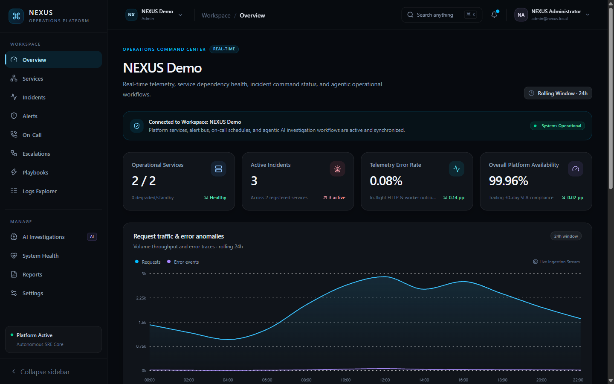
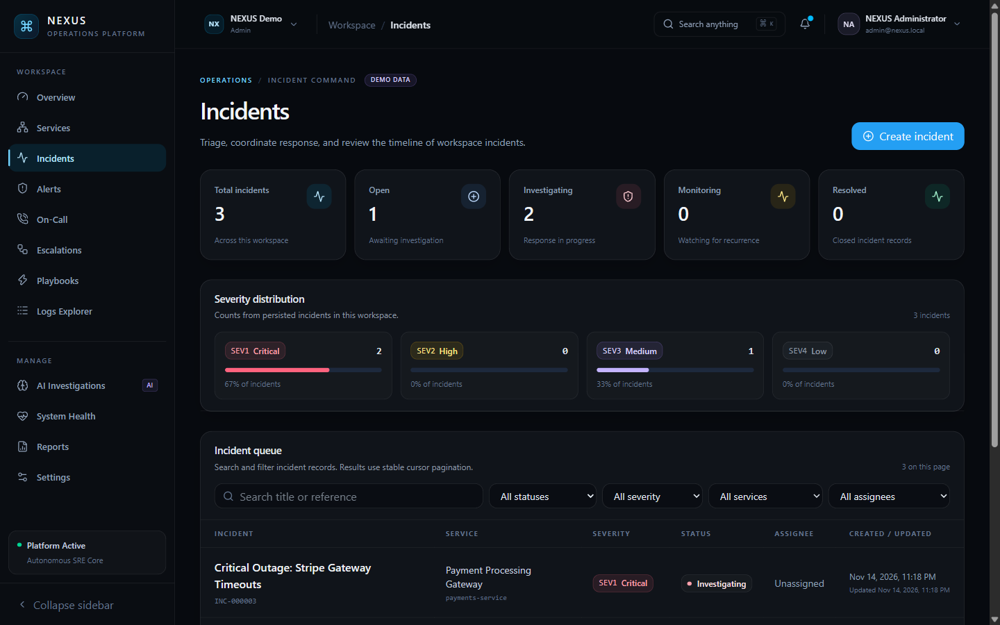
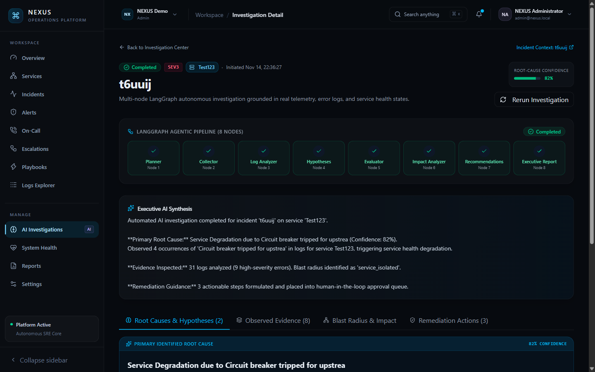
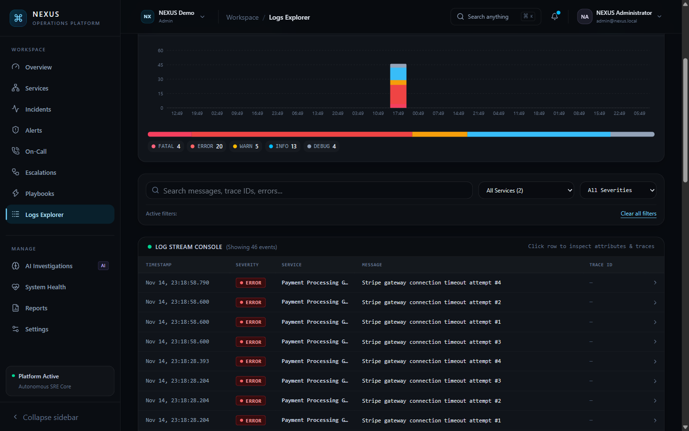
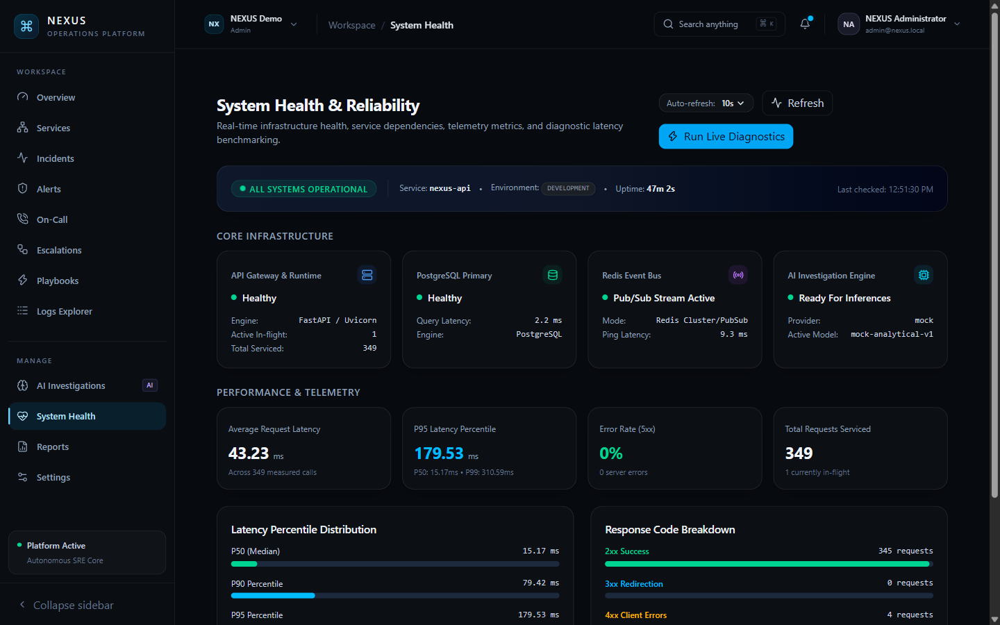
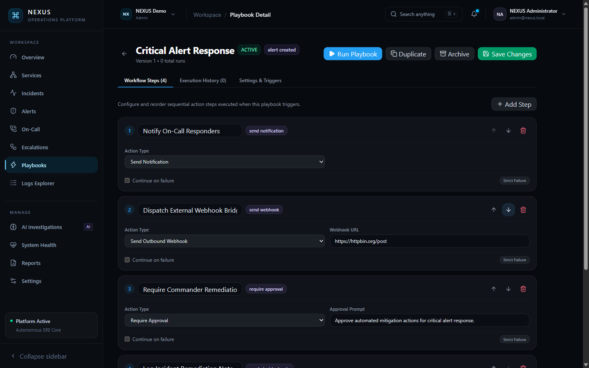
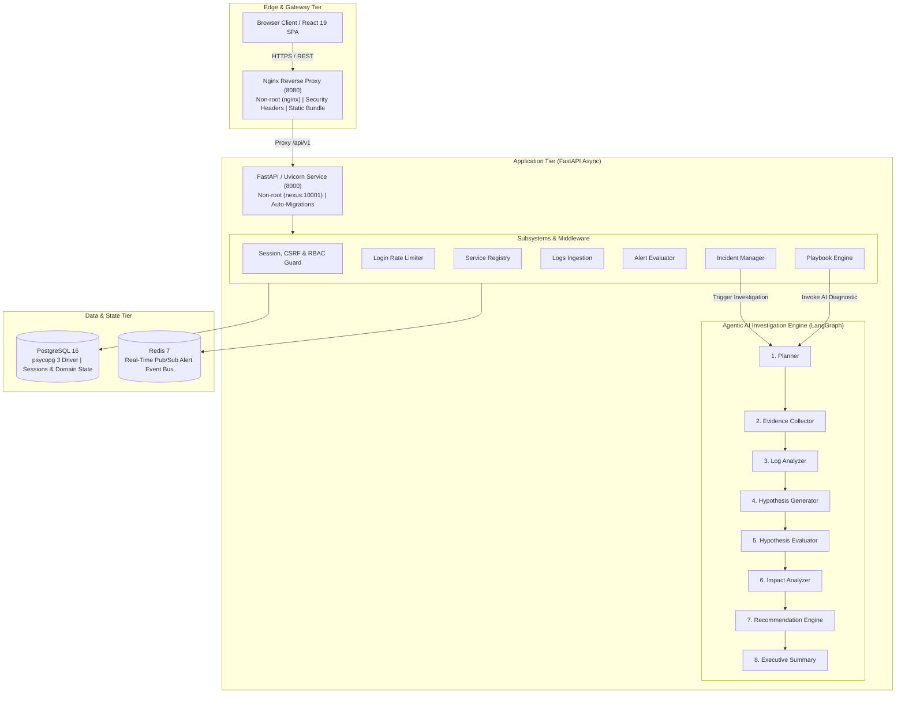

# NEXUS — Autonomous Agentic AI Operations & Incident Management Platform

[](https://react.dev)
[](https://fastapi.tiangolo.com)
[](https://python.org)
[](https://docker.com)

**NEXUS** is a production-minded, full-stack, autonomous Site Reliability Engineering (SRE) and incident operations platform. It bridges high-throughput telemetry, structured log analytics, and rule-based alert evaluation with an autonomous **multi-node LangGraph AI investigation engine** and **human-in-the-loop operational playbooks**.

Built to eliminate alert fatigue and dramatically compress Mean Time to Resolution (MTTR), NEXUS autonomously collects evidence across distributed systems, clusters log errors, generates root-cause hypotheses with confidence ratings, maps blast radius impact, and proposes or executes safe remediation runbooks.

---

## 📸 Product Screenshots

> All screenshots below were captured directly from the running local NEXUS development stack (`1440×900`) using seeded demo workspace data.

### Operations Command Center

*Real-time workspace overview displaying live service status, active incident counts, error-rate telemetry, and a 24-hour request and anomaly trend chart.*

### Incident Management Console

*Workspace-scoped incident queue with lifecycle status totals, SEV1–SEV4 severity distribution, and cursor-paginated filtering.*

### Agentic AI Investigation Pipeline (8-Node LangGraph)

*Completed 8-node LangGraph investigation displaying execution stages, root-cause confidence scoring, executive synthesis, evidence tabs, and remediation guidance.*

### Structured Log Explorer

*Stacked telemetry histogram, severity distribution bar, service and severity filters, and a structured log stream console.*

### System Health & Reliability Monitoring

*Live infrastructure probes for the API runtime, PostgreSQL, Redis pub/sub bus, and AI engine alongside latency percentile distributions and response code breakdowns.*

### Workflow Automation & Playbooks

*Multi-step operational playbook editor supporting sequential responder notifications, outbound webhooks, and human-in-the-loop approval gates.*

---

## 🧭 Platform Showcase & Screen Walkthrough

| Screen | Route | Description |
| :--- | :--- | :--- |
| **Command Center** | `/` | Real-time operational overview with live service health, active incidents, 24h error-rate trends, and quick triage actions. |
| **Services Registry** | `/services` | Microservice catalog tracking tiers, repository URLs, environment tags, operational ownership, and dependency topology. |
| **Incidents Console** | `/incidents` | Incident triage lifecycle (`OPEN → INVESTIGATING → MONITORING → RESOLVED`) with SEV1–SEV4 prioritization. |
| **Incident Detail & Timeline** | `/incidents/:id` | Unified incident command room featuring append-only audit timelines, active responders, and 1-click AI investigation. |
| **Agentic AI Investigations** | `/investigations` | Autonomous LangGraph state graph reports displaying evidence items, log error clusters, ranked root causes, and remediation playbooks. |
| **Real-Time Alert Engine** | `/alerts` | Rule-based anomaly evaluation, SHA-256 alert deduplication, fingerprinting, and automatic incident escalation. |
| **Logs Explorer** | `/logs` | Sub-millisecond structured log query engine with cursor-based pagination, severity filtering, and trace ID correlation. |
| **Operational Playbooks** | `/playbooks` | Automated runbooks featuring multi-step DAG workflows, webhook actions, and human approval gates (`require_approval`). |
| **On-Call & Escalations** | `/on-call` | Shift schedule management (daily/weekly round-robin) coupled with multi-tier timeout escalation policies (`/escalation-policies`). |
| **System Observability** | `/system-health` | Deep platform health probes (`/health`, `/ready`, `/api/v1/health/liveness`, `/api/v1/health/readiness`), Redis latency, DB pool metrics, and Prometheus exports. |
| **Analytics & Reports** | `/reports` | Executive SLA dashboard showing MTTR, MTTD, resolution rate, severity distribution, and 1-click CSV/JSON export. |
| **Workspace Settings** | `/settings` | Multi-tenant administration console covering RBAC permissions matrix, compliance controls, and integration connectors. |

---

## 🏛️ System Architecture

NEXUS uses a 3-tier micro-modular architecture designed for horizontal scalability, zero-trust tenant isolation, and deterministic operational execution:



> **Full Architecture Documentation**: See [docs/ARCHITECTURE.md](docs/ARCHITECTURE.md) and standalone Mermaid diagrams in [`docs/architecture/`](docs/architecture/).

---

## ⚡ Technology Stack

| Domain | Technology | Description |
| :--- | :--- | :--- |
| **Frontend** | React 19.3.1, TypeScript, Vite | Strict type safety, Tailwind CSS v4, Radix UI primitives, Lucide icons, Recharts SVG charting. |
| **Backend API** | FastAPI 0.115, Python 3.10+, Uvicorn | High-performance async ASGI server, Pydantic v2 validation, OpenAPI 3.1 documentation. |
| **Database & ORM** | PostgreSQL 16, SQLAlchemy 2.0 | psycopg 3 (`psycopg[binary]`) driver, connection pooling, and strictly versioned Alembic schema migrations. |
| **Event Bus** | Redis 7 | Real-time Pub/Sub alert event streaming across subscribers with automatic in-process fallback when Redis is unavailable. |
| **AI Investigation** | LangGraph (8-Node Graph) | Multi-node directed acyclic state graph orchestrating planning, evidence gathering, log analysis, hypothesis generation & evaluation, impact analysis, recommendations, and executive summary via Ollama, OpenAI-compatible APIs, or deterministic mock. |
| **Containers** | Docker, Docker Compose, Nginx | Multi-stage unprivileged Dockerfiles (`nexus:nexus`, `nginx:nginx`), 3-tier internal bridge network. |
| **CI/CD** | GitHub Actions | Matrix test runs (Python 3.10/3.11), flake8 linting, pytest, `tsc -b`, vite build, `pip-audit`, `npm audit`. |
| **Disaster Recovery** | Python 3 Backup/Restore Utilities | Gzip-compressed database backups with SHA-256 cryptographic verification and dry-run testing. |

---

## 🚀 Quickstart (Local Development)

### Prerequisites
- Docker Engine 24+ & Docker Compose 2.20+
- Node.js 20+ & npm 10+
- Python 3.10+

### Starting Local Services

```bash
# 1. Clone the repository and enter the project directory
git clone https://github.com/SarvagyaX/nexus.git
cd nexus

# 2. Initialize local environment configuration
cp .env.example .env

# 3. Launch container stack (PostgreSQL, Redis, Backend, Frontend)
docker compose up -d --build

# 4. Apply database migrations
docker compose exec backend alembic upgrade head
```

#### Optional: Seed the Local Demo Workspace
Before running the demo seed command, update `.env` with:
- `APP_ENV=development`
- `DEMO_AUTH_ENABLED=true`
- `DEMO_ADMIN_EMAIL=admin@nexus.local` (or any valid email address)
- `DEMO_ADMIN_PASSWORD=<your-password>` (**minimum 14 characters**)

Then restart the backend container if `.env` was edited after startup and run:

```bash
docker compose up -d backend
docker compose exec backend python -m app.seed
```

### Endpoints
- **Web Console**: [http://localhost:5173](http://localhost:5173)
- **REST API**: [http://localhost:8000](http://localhost:8000)
- **Interactive OpenAPI Docs**: [http://localhost:8000/docs](http://localhost:8000/docs)
- **Liveness Probe**: [http://localhost:8000/health](http://localhost:8000/health) (alias: [http://localhost:8000/api/v1/health/liveness](http://localhost:8000/api/v1/health/liveness))
- **Readiness Probe**: [http://localhost:8000/ready](http://localhost:8000/ready) (alias: [http://localhost:8000/api/v1/health/readiness](http://localhost:8000/api/v1/health/readiness); append `?full=true` for detailed dependency status)
- **Prometheus Metrics**: [http://localhost:8000/metrics](http://localhost:8000/metrics)

---

## 🔒 Production Deployment

NEXUS includes a hardened production configuration (`docker-compose.prod.yml`) that follows the principle of least privilege:

```bash
# 1. Create production environment file
cp .env.production.example .env.production

# 2. Generate secure 32-byte secret keys
openssl rand -hex 32

# 3. Configure production domain, credentials, and settings in .env.production

# 4. Launch the production stack
docker compose --env-file .env.production -f docker-compose.prod.yml up -d --build
```

### Key Security & Hardening Controls
- **Zero Public Database Exposure**: PostgreSQL and Redis run on an `internal: true` network (`nexus-db-net`) with no host port bindings.
- **Unprivileged Non-Root Containers**: Backend runs as `nexus` (UID 10001); Nginx runs as `nginx` (UID 101).
- **Strict Network Segmentation**: 3-tier internal bridge architecture (`nexus-frontend-net`, `nexus-backend-net`, `nexus-db-net`).
- **Resource Constraints**: Per-service CPU and memory limits/reservations configured in `docker-compose.prod.yml` (`frontend` and `redis`: `1.0` CPU / `512M` limit, `0.2` CPU / `128M` reservation; `backend` and `postgres`: `2.0` CPU / `2048M` limit, `0.5` CPU / `512M` reservation).
- **Automated Health Probes**: Docker daemon monitors liveness and readiness via container health checks (`/api/v1/health/liveness`, `/healthz`, `pg_isready`, `redis-cli ping`).

See [docs/PRODUCTION_DEPLOYMENT.md](docs/PRODUCTION_DEPLOYMENT.md) for full deployment procedures.

---

## 💾 Database Backup & Disaster Recovery

NEXUS includes cross-platform backup and restore utilities in `scripts/`:

```bash
# Create a timestamped, gzip-compressed backup with SHA-256 checksum
python scripts/backup_db.py

# Verify backup integrity without modifying the database
python scripts/restore_db.py --file backups/nexus_backup_<TIMESTAMP>.sql.gz --verify-only

# Safely restore a backup (requires typing 'CONFIRM-RESTORE')
python scripts/restore_db.py --file backups/nexus_backup_<TIMESTAMP>.sql.gz
```

See [docs/BACKUP_AND_RESTORE.md](docs/BACKUP_AND_RESTORE.md) for automated scheduling and disaster recovery protocols.

---

## 🧪 Automated Test Suite

NEXUS maintains a comprehensive backend and frontend test suite:

**PowerShell (Windows):**
```powershell
# Run the complete backend test suite (110 tests)
cd backend
$env:PYTHONPATH="." ; pytest tests -v

# Run frontend TypeScript type checking and production build
cd ../frontend
npm run build
```

**Bash (Linux / macOS):**
```bash
# Run the complete backend test suite (110 tests)
cd backend
PYTHONPATH=. pytest tests -v

# Run frontend TypeScript type checking and production build
cd ../frontend
npm run build
```

---

## ⚖️ Key Architectural Decisions

1. **Multi-Tenant Workspace Isolation**: Every operational model has a foreign-key constraint to `workspace_id`. Queries strictly filter on tenant context at the ORM layer, preventing cross-tenant leakage.
2. **LangGraph State Graph vs. Single-Shot LLMs**: Investigating real outages requires gathering logs, traversing microservice graphs, and analyzing trace clusters before drawing conclusions. An 8-node LangGraph state graph guarantees deterministic, verifiable progression.
3. **Human-in-the-Loop Operational Gates**: Automated remediation can be dangerous. NEXUS enforces explicit human approval (`require_approval`) on disruptive playbook actions (e.g. database failovers, traffic rerouting).
4. **Deterministic Alert Deduplication**: Alert storms are mitigated using SHA-256 fingerprinting on rule keys and metric labels, grouping duplicate alerts into a single operational lifecycle.
5. **Server-Side Session, CSRF & Workspace RBAC Defense**: Authentication uses opaque 256-bit server-side session tokens, SHA-256 hashed in PostgreSQL and delivered through `HttpOnly` cookies, paired with `HMAC-SHA256` session-bound CSRF tokens (`X-CSRF-Token`) and exact `Origin` checks for state-changing requests. Every workspace route enforces role-based access control (RBAC) against active workspace memberships and permission mappings.

---

## 🔮 Limitations & Future Scope

- **Distributed Tracing Storage**: Currently correlates logs by `trace_id`; future releases will integrate a native OpenTelemetry trace ingestion backend (e.g. Jaeger / ClickHouse).
- **Edge AI Execution**: In addition to external LLM providers (OpenAI-compatible endpoints, Ollama, local models), future work includes local quantized SLM (e.g., Llama 3 on ONNX runtime) for air-gapped on-premise deployments.
- **Kubernetes Operator**: Custom CRD operator (`NexusIncident`, `NexusPlaybook`) for native K8s pod restarts and automated scaling.

---

## 📚 Complete Documentation Suite

- [System Architecture Guide](docs/ARCHITECTURE.md)
- [Production Deployment Guide](docs/PRODUCTION_DEPLOYMENT.md)
- [CI/CD Automation Documentation](docs/CI_CD.md)
- [Database Backup & Restore Guide](docs/BACKUP_AND_RESTORE.md)
- [Environment Variables Reference](docs/ENVIRONMENT_VARIABLES.md)
- [Platform Changelog](CHANGELOG.md)
- [Release Notes (v1.0.0-rc1)](RELEASE_NOTES.md)

---

## 📄 License

No `LICENSE` file is provided in this repository. All rights remain reserved by the author unless explicit permission is granted.
